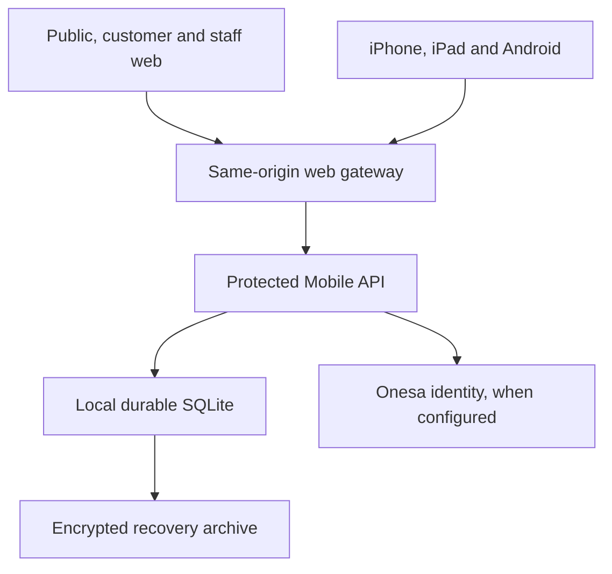
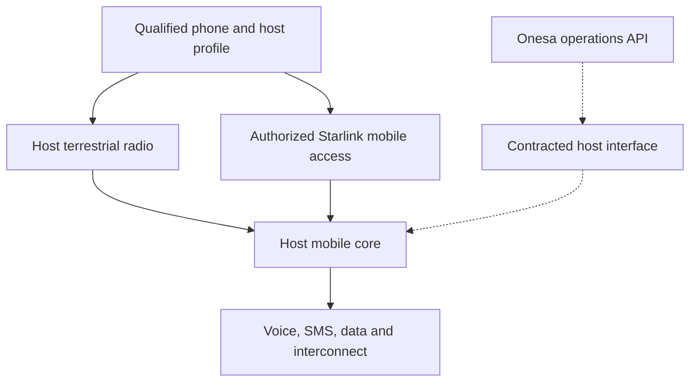

# Architecture and integration boundaries

Decision date: **5 November 2026**. Current source implements a **single-instance hardware and operations pilot**. It includes persistent authenticated workflows and a production identity configuration path. Actual telecommunications, subscriber registration and payment providers are not commissioned.

Canonical location: `DruHustle/onesa-ug/onesa-mobile`. Packages remain independently installable/buildable; the website and native app use HTTP contracts, not cross-package runtime imports.

## Implemented application topology

The public website exposes no account records. `/account/` and `/internal/` load separate customer/staff components and require server authentication/authorization. `/#demo` and `/preview/internal/` are isolated fictional examples. Route separation is a product boundary; the API is the security boundary.

The lab gateway and API have a private container network, loopback host publication, restricted capabilities and one durable volume. The API has no provider egress. The web gateway also joins an ordinary ingress bridge so Docker can publish the loopback port; its upstream remains the private API. The production overlay requires a different volume, real HTTPS ingress, explicit identity/secrets and an approved deployment environment. [Runtime guide](../infra/runtime/README.md).

The prelaunch web build is deployed to Vercel, and `mobile.onesa.eu` is attached with ownership verified. Its Cloudflare DNS record remains absent at the current receipt, so custom-domain serving and certificate readiness are pending. Hosted API routes deliberately return `503 BACKEND_NOT_CONNECTED` until the persistent API and Mobile identity client are commissioned. This hosted holding response is separate from the working local pilot topology above. [Deployment receipt and DNS target](DEPLOYMENT.md).

`ops.mobile.onesa.eu` remains a future option. A later staff-origin split needs its own exact callback/cookie/origin design; the current implementation uses a single Mobile confidential identity client with separate customer/staff surfaces, server role enforcement and staff MFA. That split is not deployed.

## Telecom topology to contract and qualify

This second diagram is a target network, not an existing integration. A Light MVNO uses the host's radio and core; Onesa focuses on customer, brand and operations. POTRAZ describes Full, Light, Reseller and MVNE categories separately. [POTRAZ licensing guidelines](https://www.potraz.gov.zw/wp-content/uploads/2025/06/Licence-Application-General-Guidelines.pdf).

Starlink's mobile architecture integrates with operators in a roaming-style arrangement. A normal Starlink broadband terminal is a separate dish/router internet path. An app, eSIM or terminal purchase does not establish Zimbabwe mobile satellite authorization or Onesa wholesale entitlement. [Starlink technical description](https://starlink.com/public-files/DIRECT_TO_CELL_SERVICE_FEB_25.pdf), [current Mobile service](https://starlink.com/mobile).

## Runtime choices and limits

| Component | Current implementation | Boundary |
| --- | --- | --- |
| Web | React, TypeScript, Vite; static output with same-origin API proxy | No secrets or real fixtures in bundles |
| Native | Expo 58 / React Native; secure store, system-browser sign-in and requested file sharing | No native radio control or assumed satellite optimization entitlement |
| API | Node 24.22.1 native HTTP, Zod, OpenID client and PDFKit | Bounded JSON input, explicit methods, exact origins, request limits |
| Persistence | SQLite WAL; one local durable database, one API replica | Pilot sizing only; not a high-availability multi-instance carrier ledger |
| Authentication state | Hashed local capabilities, encrypted upstream tokens/TOTP, source authentication time | Production must use central identity; generated lab key never becomes a production key |
| Recovery | Online SQLite backup, authenticated encryption and verified restore; explicit existing source volume and matching mode | Correct separate key required; restored local identities require controlled reissue; no overlay-order default to lab storage |
| Provider effects | Explicit unavailable routes | No activation, settlement or RF operation can be enabled by a flag |

Node 24.22.1 documents `node:sqlite` as Stability 1.2 (release candidate). The runtime is pinned for qualification and recovery is tested; this does not justify silent runtime upgrades or horizontal scaling of a shared WAL file. For a commercial multi-instance system, choose and qualify the approved transactional store and migration under actual capacity/availability requirements. [Node runtime documentation](https://nodejs.org/download/release/v24.22.1/docs/api/sqlite.html).

## Data model and mutation semantics

The domain store maintains sites, assets, trials, scoped evidence, pilot applications, support cases, test ledger entries and account requests. Each record has an immutable UUID, owner subject, positive revision and timestamps. Domain updates, audit records and idempotent outcomes commit atomically. An identical per-actor retry key returns the recorded result; a changed input/operation returns conflict. Current revisions prevent lost updates.

Inventory is a manual record. Seven required commissioning checks determine readiness; a failed check persists across unrelated passes. A declared physical fault invalidates all checks and retains its fault marker until all seven have been requalified; selecting a received state cannot clear it. Serial reference, firmware, nameplate-power and approval changes invalidate relevant checks while retaining compact history. Unknown power is explicitly unknown, and a nameplate rating is distinct from measured draw or battery endurance. Non-applicable checks require an equipment-appropriate exception and a recorded reason. Bulk pages omit history; authorized detail reads include it.

Passing manual observations require commissioned equipment, an exact device/test scope and criteria recorded before the observation. The operator selects current independently accepted evidence for the exact country, host, connectivity path and scope; direct-to-cell requires the additional satellite authorization and entitlement records and an Android phone or iPhone asset. Results capture immutable equipment configuration, commissioning state and evidence-revision snapshots. The protected asset history retains its individual checks. Observation order is compared at the form's explicit second precision. Completed observations cannot be overwritten and identify manual versus simulated sources. An accepted record is an internal evidence assessment; no record executes radio commands or claims live telemetry.

Readiness evidence is scoped by country, operator, access path and device scope, with expiry and a separate accepting reviewer. Counts span recorded scopes and do not imply universal approval. Even accepted evidence cannot activate service.

List pages use stable created-at/UUID cursors, with a maximum of 50 records. Owner/role filters apply before pagination. Customer export uses a consistent read snapshot and streams every owned record with backpressure; it does not truncate at the list limit. Financial values are explicit USD integer minor units in the lab. Refunds cannot exceed the original amount; PDFs clearly identify test receipts rather than tax invoices.

An audit hash chain detects alteration unless a privileged database administrator rewrites and recomputes the entire chain. Production needs independently controlled audit retention/anchoring. No absolute tamper-proof claim is made.

## Identity integration

Company Portal access tokens are opaque. Mobile uses confidential OIDC Authorization Code with S256 PKCE, state, nonce, signed ID-token validation and **live `/session` authorization inspection**. On every protected central request it verifies the Mobile client/product, active access, current role, original `auth_time` and staff MFA evidence. A generic JWT access-token validator would not implement this contract.

The additive Portal migration 015 and related account/admin UI enable the Mobile product only when configured. Existing AI/Drone/Robot consumers retain their three-product claims vocabulary. The Mobile client receives its expanded vocabulary. This source change does not create a live client, access grant or deployment; follow the Portal release process separately.

Web cookies are HttpOnly, Secure under HTTPS and checked with exact Origin plus CSRF on mutation. Native sessions use bearer transport and device secure storage. Native browser handoff carries only a short-lived single-use code bound to the app's state/verifier. Logout can destroy the local session during an upstream outage without authorizing any business request. Central authorization rechecks retain the local capability's revocation boundary, including concurrent logout. Web and native operations discard completed responses belonging to a session that has since changed or expired. Local SQLite database, WAL, SHM and key paths enforce private ownership/modes and reject links; host disk encryption and independent audit custody remain separate deployment responsibilities. [Security review](reviews/SECURITY_REVIEW.md), [UI/UX review](reviews/TELECOM_UX_REVIEW.md).

## Roles

| Role | Enforced API access |
| --- | --- |
| Customer | Own applications, cases, receipts, requests and export |
| Support | Subscriber review context and support/request operations; no hardware or billing writes |
| Operations | Hardware/trials, evidence submission, application review and support; cannot accept evidence or write financial records |
| Finance | Lab ledger/receipts/refunds and minimum billing-account lookup; no hardware or general subscriber directory |
| Agent | Lab sale creation and its own recorded sales; no refund authority or general customer lookup |
| Auditor | Read-only operational, financial and audit views |
| Admin | Full pilot permissions, still subject to separate evidence review, source freshness and audit |

All staff require MFA. Sensitive evidence reviews and refunds require a recent original authentication proof. Permissions are checked on every server operation and object scope. Central account access and local lab credential custody are separate responsibilities. [Threat model](THREAT_MODEL.md), [security review](reviews/SECURITY_REVIEW.md).

## Workflows that need actual provider contracts

Carrier adapters must eventually implement SIM/eSIM inventory, provisioning, suspension/replacement, number transfer and authoritative metering against documented provider interfaces. Provider event IDs, observed/received times, authentication and reconciliation are mandatory design inputs. Add durable outbox/job handling when actual external effects exist; do not substitute a synchronous mock for delivery guarantees.

Commercial billing requires approved offers, tax treatment, payment intents, authenticated provider events, settlement reconciliation, invoices/credit notes, agent cash settlement and customer remedy. Lab money records do none of those external effects. A payer, account holder, registered subscriber and SIM must remain distinct; family funding does not grant access to another adult's communications or identity documents.

Actual subscriber registration needs the approved evidence/retention process, not merely app login or a staff review reference. Define data location, controller responsibilities, incident procedure and key custody before collecting real subscriber records. See the [regulatory matrix](REGULATORY_MATRIX.md).

## Constrained connectivity

Native requests time out, reject redirects and avoid background polling; mutations retain explicit retry keys. The minimized local cache identifies age and excludes support/payment details. Documents download on request. Web lists are bounded and the UI exposes older pages. Neither client infers satellite transport from reachability.

Carrier-constrained network entitlements, Android satellite optimization declarations and physical radio testing remain separate qualification. Declaring a capability does not prove approval or useful performance. [Android guidance](https://developer.android.com/develop/connectivity/satellite/constrained-networks), [Apple entitlement](https://developer.apple.com/documentation/bundleresources/entitlements/com.apple.developer.networking.carrier-constrained.app-optimized).
