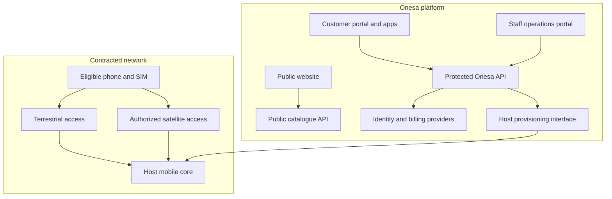

# Architecture and integration boundaries

Decision date: **5 November 2026**. These are implementation decisions and future integration requirements. The foundation consists of demo clients, a synthetic internal operations preview and a read-only API. Authentication and live customer/staff workflows remain future work.

Canonical source: the `onesa-mobile/` application directory in the existing `DruHustle/onesa-ug` repository. The application packages remain independently buildable within that directory.

## Three application surfaces

| Surface | Intended production behavior | Proposed location |
| --- | --- | --- |
| Public website | Public plan information, eligibility explanations, coverage limitations and help; no subscriber records | `mobile.onesa.eu` |
| Customer portal | Authenticated self-service for authorized accounts, subscriptions, usage, payments, invoices and support | Authenticated area of `mobile.onesa.eu` |
| Staff operations | Authorized company workflows, exception queues, reports, permissions and audit | `ops.mobile.onesa.eu` |

The domain names are proposals; they have not been configured. The repository's `/internal/` route is an unauthenticated synthetic operations preview. Its records and any local interactions confer no real staff access, provisioning authority or financial effect. The customer demo likewise does not establish an authenticated account.

Before production, give the staff portal a separate deployment/origin and identity client. Validate token audience, product scopes and per-object permissions at the backend on every protected request. Require staff MFA and explicit grants. A dedicated hostname and hidden navigation are not authorization controls. The public site must never receive internal queues, subscriber records or staff credentials.

## Two separate systems

The customer platform sells and manages an authorized subscription. The mobile network carries calls, messages and data. Building the first does not establish the second.

The diagram is a target architecture, not a claim of an existing Starlink or operator integration. Starlink's technical description explains an operator roaming-style integration; Onesa must obtain the actual contracted interfaces. [Starlink technical release](https://starlink.com/public-files/DIRECT_TO_CELL_SERVICE_FEB_25.pdf).

## Package choices

| Component | Current choice | Reason |
| --- | --- | --- |
| Web | React, TypeScript, Vite | Public site, customer demo and synthetic internal preview; independently buildable static output |
| Mobile | Expo, React Native, TypeScript | One mobile implementation with actual iOS and Android projects; iPad enabled |
| API | Node.js 24, TypeScript, native HTTP | Read-only contract foundation with no runtime dependency burden |
| Data | Fictional fixtures only | No premature collection of regulated subscriber information |
| Future storage | PostgreSQL plus approved encrypted object storage | Transactional billing/operational records and separate protected document handling |
| Future identity | Standards-based OIDC, subject to approved Onesa identity design | One identity across products, with product-specific access and roles |

Use independent packages rather than a shared runtime folder. OpenAPI is an interface contract; clients can later generate types from it without importing backend source. The current native demo uses local fixtures; it does not claim an API integration.

Keep a modular backend initially. Split billing-event processing or notifications into separate worker processes when their delivery semantics require it. Independent microservices for every screen would add operational work before there is a contracted provider.

## Future business modules

| Internal module | Intended operational work |
| --- | --- |
| Subscribers and registration | Review approved registration evidence, resolve exceptions and maintain verified subscriber state |
| Provisioning and subscriptions | Track SIM/eSIM inventory, orders, activation, renewal, suspension and replacement against host-confirmed results |
| Billing and reconciliation | Compare ledger, provider and settlement records; issue invoices/credit notes and handle authorized refunds |
| Agent cash settlements | Attribute each sale to an agent, track cash obligations and reconcile settlements |
| Support | Manage assigned cases, complaints, recovery and provider escalation |
| Providers and service readiness | Track contracted capabilities, incidents, approvals, evidence and review dates |
| Reports | Present scoped operational and financial metrics with source and freshness |
| Staff access and audit | Manage grants, approval limits and reviewable records of sensitive actions |

These are future live workflows. Internal preview fixtures illustrate the operations layout without implementing authenticated approvals, persistent records or provider mutations.

Each provider event needs its external identifier, source, received timestamp and processing status. Each money value needs an explicit currency and integer minor-unit amount. Use a transactional outbox and durable jobs when implementing effects; enforce idempotency on payments, activation and invoice issuance. Never infer success from a redirect page or an unsigned webhook.

An app user, payer, registered subscriber and SIM are different records. A parent or overseas family member can pay without gaining access to another adult's communications or ID documents. Onesa identity should assign access to this product without automatically sharing telecom records with unrelated products.

## Proposed roles and access boundaries

| Role | Minimum intended scope | Boundary |
| --- | --- | --- |
| Customer | Own account and explicitly authorized financial actions | No access to other subscribers' private records; family funding does not grant communications or ID access |
| Support | Assigned cases and necessary masked account/service status | Escalate provisioning, financial or identity-sensitive actions through approved workflows |
| Billing | Invoices, reconciliation and refunds within approved limits | No staff-role administration or unrestricted registration evidence |
| Agent | Own authorized cash sales and settlements | No unrelated customers, other agents' balances or broad subscriber search |
| Operations | Approved provisioning queues, provider incidents and service readiness | No independent financial approval or unrestricted staff administration |
| Admin | Staff grants, product configuration and audit oversight | Sensitive data/actions still require explicit scope and an audit trail |

Enforce permissions server-side using the authenticated subject, product audience, role, account/case/agent scope and requested action. Default to denial. Use separate customer and staff identity clients, short-lived sessions, staff MFA and step-up verification for sensitive changes. Define approval limits and separate approval from execution where appropriate for refunds, cash corrections and permission changes.

Retain the actor, action, target reference, outcome and correlation identifier in protected audit records. Minimize sensitive payloads and control report/export permissions. These controls require implementation and acceptance tests before live data or mutations; the current `/internal/` demo does not supply them.

## Capability model

Represent availability per **country + operator + product + device/software + service**. Keep SMS, selected-app data, app voice, native voice and emergency capability separate. Preserve statuses such as `unverified`, `partner_pending`, `test_only`, `approved` and `suspended`, with evidence and review dates.

A boolean `STARLINK_ENABLED` is insufficient. An eSIM, successful login or installed app must not be treated as satellite entitlement. Provider timeouts should preserve the last confirmed state with a timestamp instead of changing it to active.

## Mobile behavior under limited connectivity

Cache the last confirmed plan/usage with an explicit age. Use compact responses, bounded retries and user-controlled refresh. Defer document uploads and downloads. Never queue an irreversible payment operation invisibly. Explain unsent requests and allow users to retry safely.

Platform-specific constrained-network opt-ins and optimization are future work requiring testing. Android's official documentation describes explicit satellite-data optimization metadata; Apple documents carrier-constrained networking entitlements. Adding either declaration alone does not prove provider approval or good satellite performance. [Android guidance](https://developer.android.com/develop/connectivity/satellite/constrained-networks); [Apple entitlement](https://developer.apple.com/documentation/bundleresources/entitlements/com.apple.developer.networking.carrier-constrained.app-optimized).

## Production operations to design after contracting

Use a containerized local PostgreSQL development environment and an independently managed production database if the approved hosting design permits it. Keep migrations, encrypted backups and restore tests in the release process. Do not treat an external backup bucket as a database replica.

Before customer onboarding, implement OIDC token validation, authorization for every account and operational object, staff MFA, audit records, rate limits, secure secret injection, data retention and operational alerting. Determine permitted data location and key custody with the licensed provider and adviser first. The current demos have no live customer database and implement no customer or staff authentication.

Measure activation completion/failure, usage-data freshness, payment settlement mismatch, duplicate-effect prevention, refund time and provider incident recovery. Separate API uptime from radio service availability. Qualify rollback and the customer-remedy process before opening sales.
