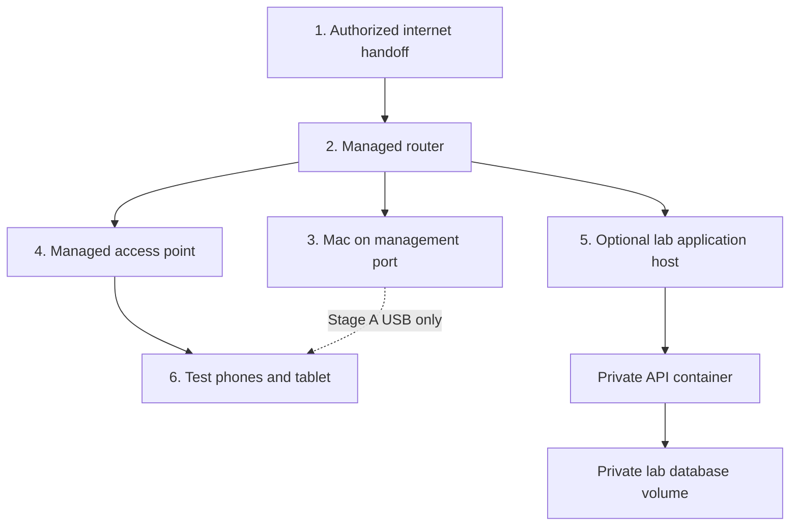

# Onesa Mobile: first physical bench

**Design reviewed 5 November 2026. Status: planned; nothing purchased, wired, measured or commissioned.**

The first useful physical delivery is one isolated device and IP test bench. Use an existing Mac and Android phone for the first USB session, then add a managed network for multiple phones/tablets. This lets Onesa verify the software, recovery and operational procedures while the host and regulatory arrangements are established. A separate Starlink broadband trial can be added later; it is not required for the first session.

## 1. Decide what Onesa is building

The proposed commercial route is a **Light MVNO**: Onesa owns the customer experience and operations platform, and a licensed host supplies the agreed mobile-network functions. POTRAZ describes this as using the host's radio access and core network. A Full MVNO has a materially different network responsibility; branded resale has different subscriber/SIM ownership. The licence and negotiated contract must settle the actual boundary. [POTRAZ licensing guidance](https://www.potraz.gov.zw/wp-content/uploads/2025/06/Licence-Application-General-Guidelines.pdf).

| Layer | Proposed accountable operator | Hardware decision for this bench |
| --- | --- | --- |
| Customer web/native app, support, applications and operations records | Onesa | Reuse development workstation and test devices; operate the isolated lab runtime |
| SIM/eSIM issuance, subscriber profiles, mobile core, voice/SMS and numbering/interconnect | Licensed host or its approved suppliers | No SIM-authentication key system, public mobile core or carrier voice equipment to purchase for this bench |
| Terrestrial radio access and spectrum | Licensed host | No local cellular base station, repeater or spectrum-capable test transmitter to purchase |
| Satellite mobile access | Starlink and authorized operator partners | Qualify the actual host-issued profile and handset; a residential dish is not this interface |
| Optional dish-based internet | Authorized broadband provider/account, with Onesa's local network | Zero terminals in the base bill of materials; separately qualify one kit if an IP-path trial needs it |

The host's subscriber traffic does not pass through the Onesa business API. An API response, website health check or Kubernetes/container status cannot establish cellular attachment, available voice service or satellite coverage.

Starlink's technical description uses mobile operators' spectrum and roaming-style integration. Current product and T-Mobile references distinguish supported messaging/apps and qualified devices from broader future capabilities. Treat those descriptions as benchmarks, not as an Onesa offer or a Zimbabwe entitlement. [Starlink technical description](https://starlink.com/public-files/DIRECT_TO_CELL_SERVICE_FEB_25.pdf), [Starlink Mobile](https://starlink.com/mobile), [T-Satellite](https://www.t-mobile.com/coverage/satellite-phone-service).

## 2. First purchase and reuse decisions

Use the quantities and selection criteria in the [hardware runbook](HARDWARE_PILOT.md#what-to-obtain-first). Do the inventory before ordering.

| Decision | Obtain or allocate | Evidence before spending or using |
| --- | --- | --- |
| Reuse first | One suitable Mac, one iPhone, two representative Android phones, access to one tablet | Custodian permission, exact model/OS, disk/device encryption, current support and clean synthetic test accounts |
| Buy only if missing | One managed router; L009UiGS-RM is the reference candidate | Local supplier/model approval, maintained firmware, VLAN/firewall recovery and measured capacity requirement |
| Add for Wi-Fi phase | One managed AP with the required tagged networks; no separate switch unless ports are insufficient | Country/radio approval, supported management isolation and compatible manufacturer-approved power |
| Prepare cabling and measurement | Six labelled Ethernet patch leads, correct Ethernet/USB adapters, suitable enclosed power meter, local recovery cable if supported | Connector, current/voltage/PoE and meter ratings; competent operator |
| Select after measurement | One UPS or packaged backup supply and encrypted removable recovery medium | Measured load/runtime worksheet, manufacturer's discharge curves, warranty, controlled restore procedure and separate key custody |
| Hold for host stage | Approved test SIMs/eSIMs and any host-specified private-connectivity equipment | Written test scope, exact interface/security requirements, authorized registration and account controls |
| Hold for optional broadband stage | One approved Starlink kit only if separately justified | Exact kit/version, authorized account/use, local equipment evidence, installation and power assessment |

The L009UiGS-RM has eight Gigabit Ethernet ports, a console connection and passive PoE output on Ether8. Its published power figures distinguish attached loads from the router alone. Those are model specifications, not measured pilot consumption or a universal AP power supply. Keep passive output disabled until the exact powered device and supply have been checked. [Manufacturer specification](https://mikrotik.com/product/l009uigs_rm).

Do not use an existing PamoFi router, terminal, production port, IP range or customer link without inventory and an explicit allocation. No such reuse has been established here. No vendor quotation, currency conversion, import total or commercial launch budget has been verified.

## 3. Numbered wiring plan

**Stage A is USB only.** Follow the existing [Android USB session](HARDWARE_PILOT.md#first-android-usb-bench-session), with the lab gateway bound to loopback and the debug app on a device in the operator's custody. It needs no new router or AP. The native build and Metro must be from the same tested source. This is application acceptance, not radio qualification.

**Stage B is the isolated multi-device network below.** Port names are a proposed mapping for the reference router, not an import script. Confirm the actual hardware, current configuration and local recovery path before applying any change.

| Connection | Proposed role | Acceptance condition |
| --- | --- | --- |
| Handoff to router Ether1 | WAN under the existing authorized internet service | Correct upstream addressing and outbound connectivity; no inbound device-management forwarding |
| Mac adapter to Ether2 | Untagged management access, proposed VLAN 10 | Only the authorized administration device can manage the router/AP; local recovery remains possible |
| Optional app host to Ether3 | Application/test segment, proposed VLAN 20 | Only the intended application gateway is exposed to test clients; API/container/database administration remains private |
| AP uplink to Ether4 | Explicit tagged trunk for management/test and optional visitor VLANs | AP management is reachable only from administration; unexpected/native VLAN traffic is rejected according to the reviewed device design |
| Test phones/tablet to test SSID | Proposed VLAN 20 | Devices reach the gateway and authorized internet services, but cannot reach management or other test clients |
| Visitor SSID if justified | Proposed VLAN 30 | Internet only; no path to management, lab host or other visitors |
| Remaining router ports | Unused/spare | Unpatched and administratively disabled unless a recorded purpose is approved |

No IP subnet is allocated by this document. Check collisions with the upstream network, Docker networks, VPNs and other Onesa sites before assigning one. Keep a port/cable label at both ends and retain a restricted network drawing with actual addresses.

The supplied Compose lab publishes `127.0.0.1:8080`; phones on Wi-Fi cannot reach that loopback listener. Continue using USB for Stage A. For Stage B, prepare a separate reviewed listener or HTTPS gateway bound only to the approved lab interface, allow only the test segment in its firewall, set exact application origins and verify the return route. Do not broaden the production or lab server to every interface as an undocumented shortcut. A second machine is optional; if the Mac hosts the gateway, document its exact interface/firewall and avoid bridging management and test networks through the workstation.

Keep the database volume and API management inside the private runtime. A real backend on Oracle is a separate deployment with approved identity, data location and secret custody. The Vercel website's current unavailable API response is expected and cannot satisfy this bench's authenticated-workflow tests. See [deployment status](DEPLOYMENT.md) and [runtime instructions](../infra/runtime/README.md).

## 4. Isolation and change acceptance

Before changing the router/AP, retain a protected configuration export, model/firmware inventory and recovery instructions that the local custodian can execute. Keep serial numbers, Wi-Fi credentials and private addresses out of public issues and screenshots. A factory reset is not an assumed rollback: it may erase the only working access path.

Run this matrix for both IPv4 and IPv6, or explicitly document that IPv6 is intentionally disabled and verify it cannot route. Capture actual observations and the rule/configuration revision.

| Source | Destination | Expected result |
| --- | --- | --- |
| Authorized management device | Router/AP administration | Allowed through the chosen authenticated management path |
| Test device | Lab application gateway | Allowed only on the qualified application port/origin |
| Test device | Router/AP administration, API management, database | Denied |
| Test device | Another test device | Denied unless a specific test needs a reviewed temporary exception |
| Visitor | Management, test segment, lab host or another visitor | Denied |
| Test/visitor | Authorized internet service | Allowed according to the documented outbound policy |
| Public WAN | Router/AP administration, API management, database | Denied |
| Any test device with a different VLAN tag or unapproved SSID | A more privileged segment | Denied |

Verify DNS, time synchronization, restart behavior and the effect of losing upstream connectivity. If remote maintenance is needed, choose an explicitly reviewed outbound private-access arrangement and preserve a local recovery route. Do not open public management ports. The VLAN design must follow the actual device's documented bridge/CPU-port behavior. [MikroTik bridge/VLAN documentation](https://manual.mikrotik.com/docs/bridging-and-switching/).

## 5. Power and recovery worksheet

All measurements begin **unknown**. A manufacturer's maximum is a selection bound; it is not a reading from the installed bench. Include supplied power adapters, PoE loads and any optional terminal at the same measurement boundary so loads are not counted twice.

| Field | Record before selecting the backup supply |
| --- | --- |
| Included equipment | Exact router/AP/switch/optional terminal and power supplies; list excluded laptop/phone charging separately |
| Measurement | Meter/reference, operator, time, supply voltage, idle watts, representative average watts, observed peak/inrush and evidence reference |
| Environment | Temperature, ventilation, battery location and safe cable/earthing arrangement |
| Runtime target | Proposed two hours for network equipment, to be accepted by the owner; include a planned orderly shutdown margin |
| Capacity assumptions | Manufacturer-permitted usable battery fraction, conversion efficiency and explicit aging/temperature margin |
| Backup selection | Both continuous/peak power rating and usable energy/discharge curve; VA rating alone is insufficient |
| Verification | Controlled power interruption, actual elapsed runtime, low-battery behavior, no configuration loss, restart and restored application state |

Use this engineering estimate only after measurements exist:

`nominal battery Wh = measured load W × target hours × design margin ÷ (usable fraction × efficiency)`

**Invented worked example:** 20 W average network load × 2 h × 1.25 design margin ÷ (0.80 usable fraction × 0.85 efficiency) = **73.5 Wh** nominal. This is not a quoted UPS specification or an assertion that the proposed router/AP consumes 20 W. An optional satellite kit must be measured separately and the calculation repeated. Recheck instantaneous power, startup and the manufacturer's load/runtime curve; then prove runtime on the actual bench. A qualified installer handles mains work, surge protection, earthing and outdoor installations.

Recover a protected configuration backup in a controlled bench exercise and verify the isolation matrix again. After a supply, firmware, cabling, PoE load or configuration change, invalidate the relevant earlier check and retain its history. A failed check stays failed until the corrective action is demonstrated.

## 6. Move from software tests to permitted radio tests

Use separate test records for application-over-IP, host terrestrial service and handset direct-to-cell. An app speed test cannot identify the network bearer. For a dish connection, use the `dish_wifi` path and identify the broadband account/terminal. For D2C, identify the handset and host-issued profile by non-secret references and retain the agreed network/device evidence of actual satellite attachment.

The [trial-authority policy](REGULATORY_MATRIX.md#test-permission-and-commercial-release) requires scoped permission evidence before a passing manual radio observation can be accepted. It does not let an internal reviewer create legal authority. Device/service acceptance is the output of the qualification process and must be reviewed after the trial, separately from permission to run it.

Agree test targets before execution: permitted functions, locations, observation interval, attempt count, success threshold, delay/time-out threshold and stop conditions. Record failed and blocked observations as well as successful ones. Treat app-based voice, ordinary dialler voice, SMS, data, roaming and emergency access as different functions. Use authorized emergency test facilities only. Never interpret a small outdoor sample as universal, indoor or national coverage.

Retain the handset SKU, OS/carrier software, app commit/build, host/profile reference, actual transport evidence, local/UTC time, obstruction/weather notes, result, measurement units and operator. A later firmware or entitlement change creates a new qualification scope; it must not rewrite the historical observation.

## 7. First session handover

The custodian should receive one reviewable packet: asset inventory, actual cable/port diagram, protected configuration backup reference, measurement worksheet, test-build IDs, completed acceptance rows, unresolved faults, and rollback instructions. Keep the sign-off limited to what was observed.

The session is complete when the recorded devices launch the intended build, synthetic customer/staff workflows work through the intended lab route, prohibited network paths fail, power/restart and backup restore have been demonstrated, and each result has an owner/evidence reference. That outcome commissions a bench. It does not enable subscriber sales, SIM provisioning, a carrier interconnect or satellite service.

The information still needed from the owner is the pilot location/custodian, available Mac and phone models/OS versions, existing router/AP models and firmware, authorized internet handoff, power conditions and spending ceiling. These are required inputs for actual device-specific configuration and quotations, not reasons to invent a configuration now.
